<p align="center">
  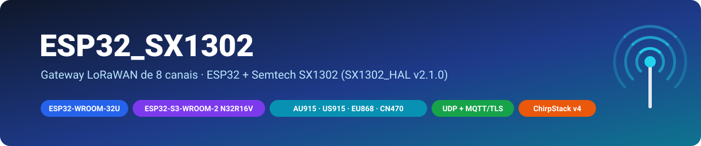
</p>

<p align="center">
  <a href="https://github.com/AdailSilva/ESP32-with-SX1302-Gateway/actions/workflows/build.yml"></a>
  
  
  
  
  
</p>

**ESP32_SX1302** é um gateway LoRaWAN de **8 canais** e baixo custo. Ele usa um **ESP32** no lugar do Raspberry Pi e um concentrador **Semtech SX1302**, com o porte do [SX1302_HAL v2.1.0](https://github.com/Lora-net/sx1302_hal). O firmware conversa com o **ChirpStack** (ou qualquer servidor compatível) por **UDP Semtech** ou por **MQTT/MQTTS** no protocolo de gateway do ChirpStack v4. A configuração é feita por uma página web em português ou pelo console serial.

O mesmo código-fonte gera firmware para **duas placas**:

| Alvo | Placa | Papel |
|---|---|---|
| `esp32` | **ESP32-WROOM-32U DevKit** | Versão de **menor recurso**: tem todas as funções que existem hoje |
| `esp32s3` | **ESP32-S3-WROOM-2 (N32R16V) DevKit** | Versão de **maior recurso**: tudo o que já existe **e** as funções novas ([roadmap](#-roadmap-esp32-s3)) |

---

## Sumário

- [Placas suportadas](#-placas-suportadas)
- [Funcionalidades](#-funcionalidades)
- [Arquitetura do firmware](#-arquitetura-do-firmware)
- [Hardware e materiais](#-hardware-e-materiais)
- [Pinagem: ESP32-WROOM-32U DevKit](#-pinagem-esp32-wroom-32u-devkit)
- [Pinagem: ESP32-S3-WROOM-2 (N32R16V) DevKit](#-pinagem-esp32-s3-wroom-2-n32r16v-devkit)
- [Header do LR1302 HAT](#-header-de-40-pinos-do-lr1302-hat)
- [Alimentação](#-alimentação)
- [Compilar e gravar](#-compilar-e-gravar)
- [Primeiro uso](#-primeiro-uso)
- [Servidor web embutido](#-servidor-web-embutido)
- [Configuração](#-configuração)
- [Roadmap (ESP32-S3)](#-roadmap-esp32-s3)
- [Estrutura do repositório](#-estrutura-do-repositório)
- [Solução de problemas](#-solução-de-problemas)
- [Créditos e licença](#-créditos-e-licença)

---

## 🧩 Placas suportadas

<p align="center">
  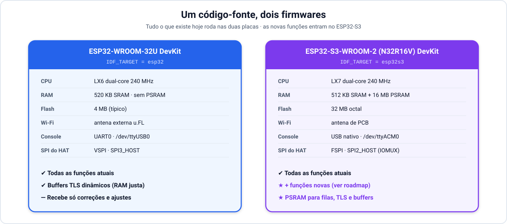
</p>

| | ESP32-WROOM-32U DevKit | ESP32-S3-WROOM-2 (N32R16V) DevKit |
|---|---|---|
| `IDF_TARGET` | `esp32` | `esp32s3` |
| CPU | Xtensa LX6 dual-core, 240 MHz | Xtensa LX7 dual-core, 240 MHz |
| RAM | 520 KB SRAM, sem PSRAM | 512 KB SRAM + **16 MB PSRAM octal** |
| Flash | 4 MB (típico) | **32 MB octal** |
| Antena Wi-Fi | externa (conector u.FL) | de PCB |
| Console | UART0 (chip USB-UART), `/dev/ttyUSB0` | USB nativo (Serial/JTAG), `/dev/ttyACM0` |
| SPI do HAT | VSPI, `SPI3_HOST` (GPIO 18/19/23/5) | FSPI, `SPI2_HOST` em IOMUX (GPIO 10–13) |
| LED de status | GPIO2 (LED azul da DevKit) | — (o LED da DevKit é RGB WS2812) |
| Botão Soft AP | GPIO0 (BOOT) | GPIO0 (BOOT) |

A pinagem de cada placa fica em um bloco `if(IDF_TARGET ...)` de [`main/CMakeLists.txt`](main/CMakeLists.txt). As opções do chip ficam em [`sdkconfig.defaults`](sdkconfig.defaults) (comum às duas) e [`sdkconfig.defaults.esp32s3`](sdkconfig.defaults.esp32s3) (flash/PSRAM octais e console USB). O ESP-IDF carrega esses arquivos sozinho conforme o alvo.

---

## ✨ Funcionalidades

Legenda: ✅ disponível · 🧪 disponível, falta validar em campo · 🗓️ planejado · ➖ não se aplica

### Rádio e LoRaWAN

| Função | ESP32 | ESP32-S3 |
|---|:---:|:---:|
| Concentrador SX1302 + SX1250, **8 canais** multi-SF + canal LoRa de serviço + FSK | ✅ | ✅ |
| Planos de frequência **AU915 SB0** (canais 0–7 + 64), **AU915 SB1** (8–15 + 65, padrão), **US915**, **EU868**, **CN470** | ✅ | ✅ |
| Frequência central dos rádios editável, com volta ao padrão do plano | ✅ | ✅ |
| Downlink com **JIT queue** (agendamento de TX) | ✅ | ✅ |
| Class B: beacon AU915 (923,3 MHz + n × 600 kHz, SF12BW500) | 🧪 | 🧪 |
| Compensação de RSSI pela temperatura (STTS751 no I2C; sem sensor, usa 25 °C) | ✅ | ✅ |
| SX1261 mantido fora do barramento SPI (CS em nível alto) | ✅ | ✅ |
| LBT / spectral scan com o SX1261 | ➖ | 🗓️ |
| GPS do HAT (NMEA) e sincronismo por PPS | ➖ | 🗓️ |

### Rede e integração

| Função | ESP32 | ESP32-S3 |
|---|:---:|:---:|
| Wi-Fi **Station** com DHCP ou **IP fixo** (IP, máscara, gateway, DNS 1 e 2) | ✅ | ✅ |
| Wi-Fi **Soft AP** de configuração (`192.168.4.1`), por botão ou falha de conexão | ✅ | ✅ |
| NTP configurável (padrão `br.pool.ntp.org`) | ✅ | ✅ |
| Packet forwarder **UDP Semtech** (ChirpStack Gateway Bridge, porta 1700) | ✅ | ✅ |
| **MQTT / MQTTS**: TLS com CA própria ou bundle público, **mTLS** (certificado + chave do cliente), usuário/senha | ✅ | ✅ |
| Formato **ChirpStack v4** em **JSON** ou **Protobuf** (uplink, stats, ack, conn state e downlink em `command/down`) | ✅ | ✅ |
| Formato Semtech JSON por MQTT (somente uplink) | ✅ | ✅ |
| UDP e MQTT exclusivos: MQTT ligado desliga o UDP | ✅ | ✅ |
| Buffers TLS dinâmicos (economia de RAM sem PSRAM) | ✅ | ✅ |
| TLS e filas grandes na PSRAM | ➖ | 🗓️ |
| Buffer offline em flash (guarda uplinks quando o broker cai) | ➖ | 🗓️ |
| Atualização OTA | ➖ | 🗓️ |

### Gestão e observabilidade

| Função | ESP32 | ESP32-S3 |
|---|:---:|:---:|
| **Página web em pt-BR**: tema claro/escuro, adaptada ao celular, validação nos campos | ✅ | ✅ |
| Painel de **status** (`GET /status`): uptime, heap, RSSI do Wi-Fi, temperatura, pacotes RX/TX, ACKs | ✅ | ✅ |
| **Log ao vivo** no navegador (`/logs`), com filtro, pausa e download (buffer circular de 16 KB) | ✅ | ✅ |
| **Diagnóstico de rede** (`/diag`): ping, traceroute e nslookup | ✅ | ✅ |
| Envio de certificados MQTT pela página | ✅ | ✅ |
| Login da página (padrão `admin` / `lorawan`), troca de senha e logout | ✅ | ✅ |
| **Console serial** `ESP32_SX1302>` (`config`, `mqtt`, `mqtt_cert`, `web_auth`, `pkt_fwd`, `reboot`) | ✅ | ✅ |
| Web e console gravam as mesmas configurações na NVS | ✅ | ✅ |
| Diagnóstico de fiação do SX1302 quando o concentrador não inicia | ✅ | ✅ |
| Display OLED SSD1306 opcional no I2C | 🧪 | 🧪 |
| LED de status | ✅ (GPIO2) | 🗓️ (LED RGB WS2812) |
| Painel web completo (gráficos, histórico) | ➖ | 🗓️ |

---

## 🏗️ Arquitetura do firmware

<p align="center">
  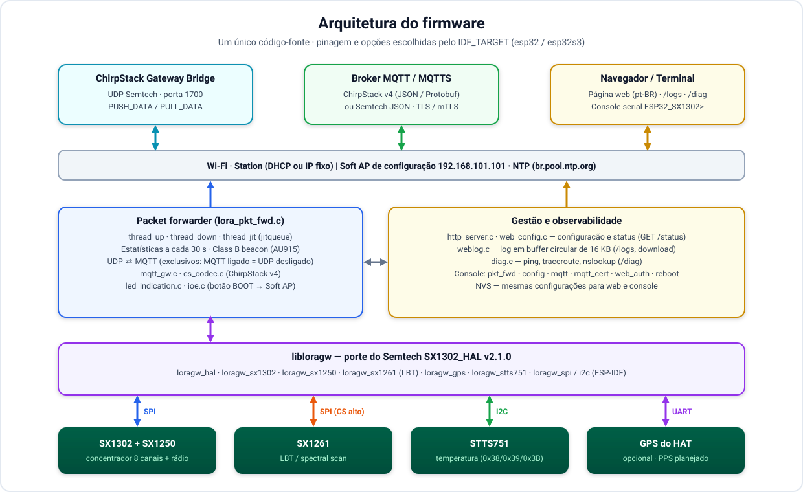
</p>

- **`main/libloragw/`** é o porte do Semtech SX1302_HAL v2.1.0 para o ESP-IDF (SPI, I2C e UART pelo driver do ESP-IDF).
- **`main/packet_forwarder/`** contém o forwarder (`lora_pkt_fwd.c`), o cliente MQTT (`mqtt_gw.c`, `cs_codec.c`), o servidor web (`http_server.c`, `web_config.c`), o log (`weblog.c`), o diagnóstico (`diag.c`) e os LEDs/botões (`led_indication.c`, `ioe.c`).
- **`main/libloragw-test/`** guarda as ferramentas de teste (`test_hal_tx`, `test_hal_rx`, `test_toa`). Elas entram no lugar do forwarder quando `CONFIG_LIBLORAGW_TEST=1`.

---

## 🔧 Hardware e materiais

| Item | Observação |
|---|---|
| **ESP32-WROOM-32U DevKit** (38 pinos) **ou** **ESP32-S3-WROOM-2 N32R16V DevKitC-1** | O WROOM-32U precisa de antena Wi-Fi u.FL |
| **Elecrow LR1302 LoRaWAN HAT** (versão **SPI**) | SX1302 + SX1250 + SX1261, header de 40 pinos no padrão Raspberry Pi |
| Antena LoRa 915 MHz | **Nunca** ligue o gateway sem antena |
| Fonte **5 V / 2 A** | O USB do PC não aguenta os picos de TX em uso contínuo |
| 12 jumpers fêmea-fêmea **curtos** (< 15 cm) | 10 se não usar o GPS |
| *(opcional)* Display OLED SSD1306 I2C | Divide o barramento I2C com o sensor de temperatura |

> As pastas `hardware_design/` (placa-mãe e caixa) e `doc/SSD1306.pdf` são do projeto original, que usava uma placa de interface própria. Elas ficam no repositório como referência. As duas placas deste README usam DevKits comuns ligadas direto ao HAT.

---

## 📌 Pinagem: ESP32-WROOM-32U DevKit

<p align="center">
  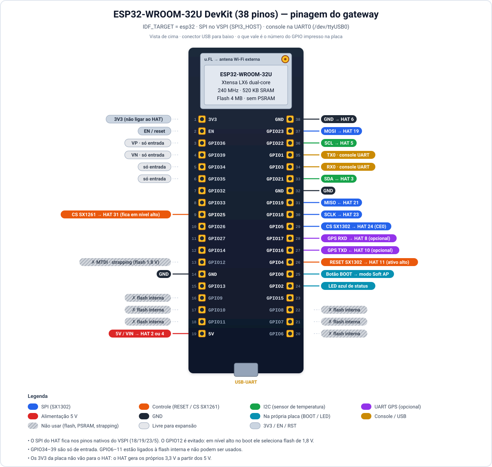
</p>

<p align="center">
  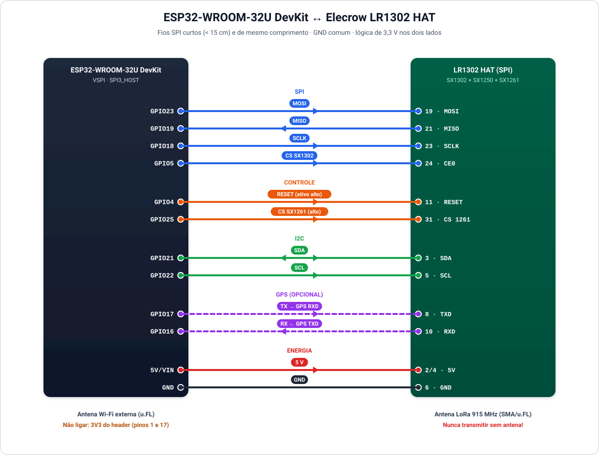
</p>

| Sinal | ESP32 | → | HAT (pino) | Nome RPi |
|---|---|:---:|---|---|
| 🔵 SPI MOSI | **GPIO23** | → | **19** | GPIO10 / MOSI |
| 🔵 SPI MISO | **GPIO19** | ← | **21** | GPIO9 / MISO |
| 🔵 SPI SCLK | **GPIO18** | → | **23** | GPIO11 / SCLK |
| 🔵 CS do SX1302 | **GPIO5** | → | **24** | GPIO8 / CE0 |
| 🟠 RESET do SX1302 (ativo alto) | **GPIO4** | → | **11** | GPIO17 |
| 🟠 CS do SX1261 (fica em nível alto) | **GPIO25** | → | **31** | GPIO6 |
| 🟢 I2C SDA | **GPIO21** | ↔ | **3** | GPIO2 / SDA |
| 🟢 I2C SCL | **GPIO22** | → | **5** | GPIO3 / SCL |
| 🟣 GPS RXD *(opcional)* | **GPIO17** | → | **8** | GPIO14 / TXD |
| 🟣 GPS TXD *(opcional)* | **GPIO16** | ← | **10** | GPIO15 / RXD |
| 🔴 5 V | **5V / VIN** | → | **2** ou **4** | 5V |
| ⚫ GND | **GND** | — | **6** | GND |

Guia completo, com o diagrama em texto e a conferência pós-ligação: [`doc/hardware/ESP32-WROOM-32U_DevKit.md`](doc/hardware/ESP32-WROOM-32U_DevKit.md).

---

## 📌 Pinagem: ESP32-S3-WROOM-2 (N32R16V) DevKit

<p align="center">
  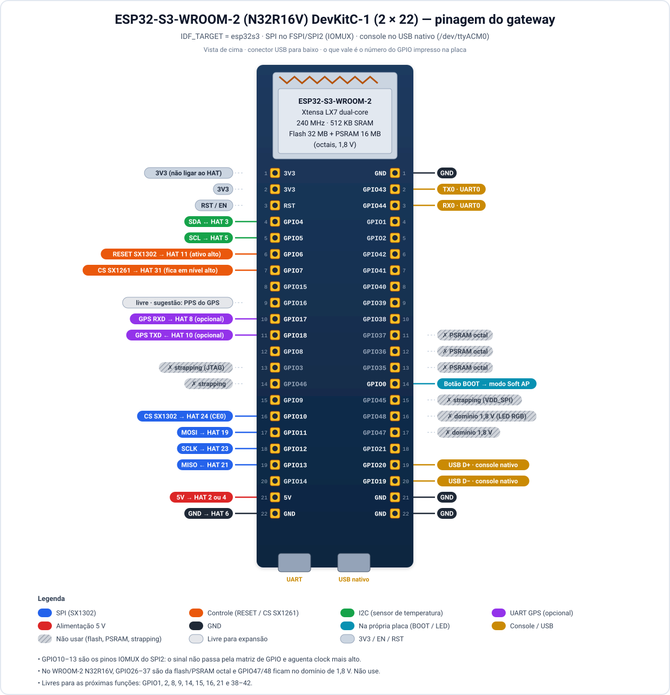
</p>

<p align="center">
  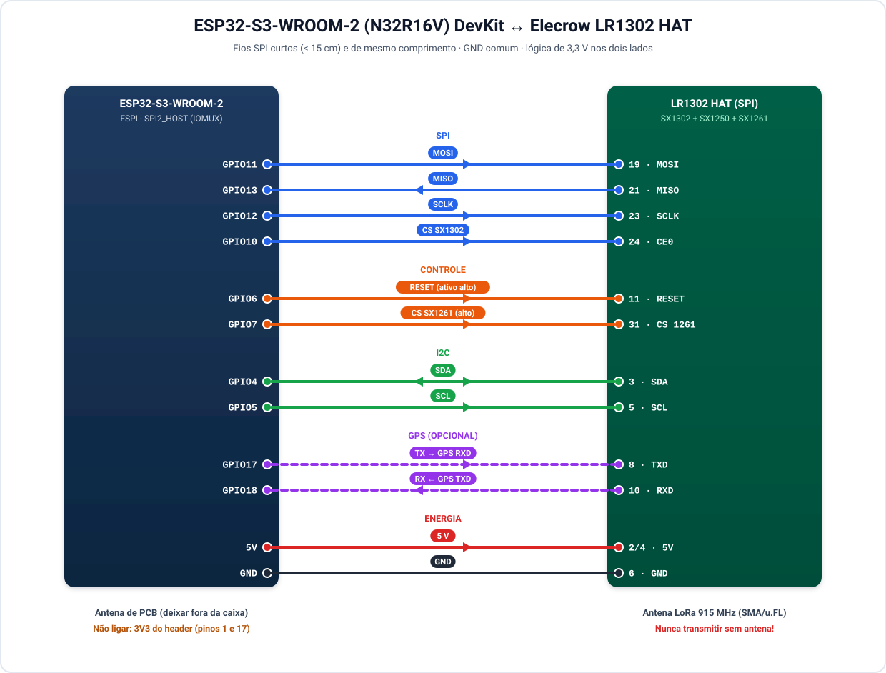
</p>

| Sinal | ESP32-S3 | → | HAT (pino) | Nome RPi |
|---|---|:---:|---|---|
| 🔵 SPI MOSI | **GPIO11** | → | **19** | GPIO10 / MOSI |
| 🔵 SPI MISO | **GPIO13** | ← | **21** | GPIO9 / MISO |
| 🔵 SPI SCLK | **GPIO12** | → | **23** | GPIO11 / SCLK |
| 🔵 CS do SX1302 | **GPIO10** | → | **24** | GPIO8 / CE0 |
| 🟠 RESET do SX1302 (ativo alto) | **GPIO6** | → | **11** | GPIO17 |
| 🟠 CS do SX1261 (fica em nível alto) | **GPIO7** | → | **31** | GPIO6 |
| 🟢 I2C SDA | **GPIO4** | ↔ | **3** | GPIO2 / SDA |
| 🟢 I2C SCL | **GPIO5** | → | **5** | GPIO3 / SCL |
| 🟣 GPS RXD *(opcional)* | **GPIO17** | → | **8** | GPIO14 / TXD |
| 🟣 GPS TXD *(opcional)* | **GPIO18** | ← | **10** | GPIO15 / RXD |
| 🔴 5 V | **5V** | → | **2** ou **4** | 5V |
| ⚫ GND | **GND** | — | **6** | GND |

> ⚠️ **Não use** no WROOM-2 N32R16V: GPIO26–37 (flash/PSRAM octal), GPIO47/48 (domínio de 1,8 V), GPIO19/20 (USB do console), GPIO43/44 (UART0) e GPIO0/3/45/46 (strapping). Ficam livres para as funções novas: GPIO1, 2, 8, 9, 14, 15, 16, 21 e 38–42.

Guia completo: [`doc/hardware/ESP32-S3-WROOM-2_N32R16V_DevKit.md`](doc/hardware/ESP32-S3-WROOM-2_N32R16V_DevKit.md).

---

## 🟩 Header de 40 pinos do LR1302 HAT

O HAT é o mesmo nas duas placas. Muda só o GPIO do ESP32 em cada pino:

<p align="center">
  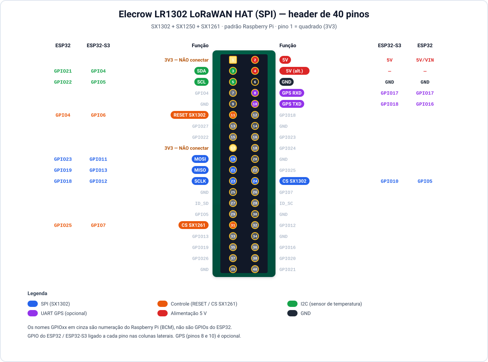
</p>

- **Não ligue os 3V3 do header (pinos 1 e 17).** O HAT gera os próprios 3,3 V a partir dos 5 V.
- O LR1302 HAT **não tem POWER_EN** (`SX1302_POWER_EN_PIN=GPIO_NUM_NC`).
- A lógica do HAT é de 3,3 V, igual à do ESP32. Não precisa de conversor de nível.

---

## ⚡ Alimentação

<p align="center">
  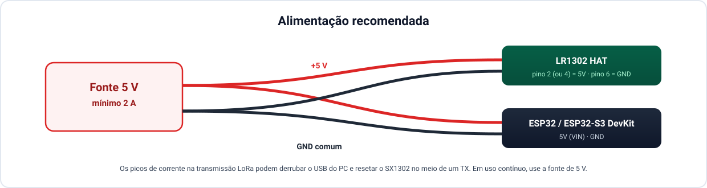
</p>

Durante o desenvolvimento, dá para alimentar tudo pelo USB da DevKit (o 5V/VIN segue para o HAT). Se aparecer *brownout* ou reset na hora de transmitir, a causa é a alimentação: use a fonte de 5 V / 2 A com GND comum.

---

## 🛠️ Compilar e gravar

### Requisitos

- [ESP-IDF](https://docs.espressif.com/projects/esp-idf/) **v5.5.1** (também compila no 6.x).
- Python 3 (vem com o ESP-IDF).

```bash
git clone -b v5.5.1 --recursive https://github.com/espressif/esp-idf.git
cd esp-idf && ./install.sh esp32,esp32s3 && . ./export.sh
```

### Com o script do projeto (recomendado)

[`scripts/build.sh`](scripts/build.sh) gera os headers embutidos (página web e planos de frequência) e compila cada alvo em uma pasta própria. Assim um alvo não sobrescreve o outro.

```bash
git clone https://github.com/AdailSilva/ESP32-with-SX1302-Gateway.git
cd ESP32-with-SX1302-Gateway

# ESP32-WROOM-32U DevKit  -> build-esp32/   + sdkconfig.esp32
./scripts/build.sh esp32
./scripts/build.sh esp32 flash /dev/ttyUSB0        # grava e abre o monitor

# ESP32-S3-WROOM-2 N32R16V -> build-esp32s3/ + sdkconfig.esp32s3
./scripts/build.sh esp32s3
./scripts/build.sh esp32s3 flash /dev/ttyACM0      # porta USB nativa, não a "UART"
```

### Com `idf.py` direto

```bash
./scripts/gen_headers.sh                            # gera webpage.h e global_json.h
idf.py -B build-esp32s3 -D SDKCONFIG=sdkconfig.esp32s3 -D IDF_TARGET=esp32s3 build
idf.py -B build-esp32s3 -D SDKCONFIG=sdkconfig.esp32s3 -p /dev/ttyACM0 flash monitor
```

> `webpage.h` e `global_json.h` são gerados e ficam fora do git. Depois de editar `main/packet_forwarder/webpage.html` ou os JSON de `global_conf.json/`, rode `scripts/gen_headers.sh` de novo (o `build.sh` já faz isso).

### Com PlatformIO

Abra a pasta no VS Code com a extensão PlatformIO e escolha o ambiente **`esp32dev`** (ESP32-WROOM-32U) ou **`esp32s3`** (ESP32-S3-WROOM-2). O script `platformio_pre.py` gera a página web antes do build.

### Binários prontos (GitHub Actions)

O workflow [`.github/workflows/build.yml`](.github/workflows/build.yml) compila as **duas placas** a cada push e pull request e publica os `.bin` como *artifacts*. Ao criar uma tag `v*` (por exemplo `v0.0.1`), ele também cria uma **Release** com os arquivos:

```
esp32_sx1302-<versão>-esp32.bin      bootloader-esp32.bin      partition-table-esp32.bin
esp32_sx1302-<versão>-esp32s3.bin    bootloader-esp32s3.bin    partition-table-esp32s3.bin
```

As versões deste repositório começam em **v0.0.1**. A tag precisa ser igual à versão do firmware, definida em `ESP32_SX1302_VERSION` ([`main/packet_forwarder/loragw_version.h`](main/packet_forwarder/loragw_version.h)). Se forem diferentes, o workflow falha antes de publicar a Release. O histórico do projeto original (v0.6.0 a v0.9.1) continua no [CHANGELOG](doc/CHANGELOG.md).

Para lançar uma versão nova: atualize `ESP32_SX1302_VERSION` e o CHANGELOG, faça o commit e depois rode:

```bash
git tag -a v0.0.2 -m "v0.0.2" && git push origin v0.0.2
```

Para gravar um binário baixado, use os endereços de `flasher_args-<alvo>.json`. No ESP32 eles são: bootloader `0x1000`, tabela de partição `0x8000` e aplicação `0x10000`. No ESP32-S3 o bootloader fica em `0x0`.

---

## 🚀 Primeiro uso

1. Ligue o gateway **com a antena LoRa conectada**.
2. Na primeira vez (ou segurando o botão **BOOT** logo depois do reset), ele sobe em **Soft AP**:
   - Rede Wi-Fi: **`esp32`**, senha **`esp32wifi`**.
   - Abra **http://192.168.4.1** (é *http*, não *https*).
   - Login da página: **`admin` / `lorawan`**. Troque a senha na seção *Acesso a esta página*.
3. Configure o **Wi-Fi Station**, o **plano de frequência** (AU915 SB1 é o padrão), o **Gateway ID** e o modo de envio (**UDP** ou **MQTT**). Salve e reinicie.
4. No ChirpStack, cadastre o gateway com o mesmo **Gateway ID**.
5. No monitor serial, o boot deve mostrar:

```
INFO: [main] concentrator started, packet can now be received
I (...) gw_mqtt: connected to the broker          ← quando o MQTT está ligado
```

---

## 🖥️ Servidor web embutido

O gateway traz um servidor HTTP próprio (`esp_http_server`, porta **80**) com quatro telas: **Configuração** (com o painel de status), **Logs**, **Diagnósticos** e o **JSON dos planos de frequência**, além das páginas curtas de confirmação. Tudo fica gravado na flash do firmware, não depende de internet nem de CDN e funciona igual no ESP32 e no ESP32-S3.

- **Endereço:** `http://192.168.4.1` em Soft AP, ou o IP que o roteador entregou (ou o IP fixo configurado) em Station. É *http*, não *https*.
- **Tema:** claro ou escuro, conforme o tema do sistema operacional/navegador (`prefers-color-scheme`). `/w` é um apelido de `/` mantido por compatibilidade.
- **Celular:** todas as telas se adaptam a telas estreitas (menu vira uma lista de botões, cartões em 2 colunas, campos em 1 coluna).
- **Código:** `main/packet_forwarder/webpage.html` (configuração), `logs_page.h`, `diag_page.h` e as páginas curtas em `http_server.c`. Depois de editar o `webpage.html`, rode `scripts/gen_headers.sh` (o `build.sh` já faz isso).

> As capturas abaixo foram geradas a partir do HTML/JS real do firmware, servido com **dados de exemplo** (Gateway ID `E45F01FFFE10E12E`, broker `mqtt.exemplo.com.br`, servidor `chirpstack.exemplo.com.br`). Os números não são de um gateway em campo.

### 🔐 Login e sessão

Todas as páginas e chamadas usam **HTTP Basic Auth**. O navegador abre a janela de usuário e senha dele mesmo na primeira visita.

| Item | Detalhe |
|---|---|
| Login padrão | `admin` / `lorawan` |
| Trocar | Seção **Acesso** da página ou `web_auth --user <u> --pass <p>` no console. Vale **na hora**, sem reiniciar |
| Esqueceu a senha | `web_auth --reset` no console serial (volta para `admin` / `lorawan`) |
| Regras | Usuário de 1 a 31 caracteres; senha de 6 a 31; nenhum dos dois pode ter `:`; o usuário `_logout_` é reservado |
| Sair | Link **Sair** no topo de qualquer tela. Pede confirmação, troca o login guardado pelo navegador por um login falso (`_logout_`) e abre a tela **Você saiu**. O próximo acesso pede usuário e senha de novo |
| Sem login | Só `/favicon.svg`, `/favicon.ico` e `/saiu` |

As senhas (Wi-Fi, MQTT e da página) **nunca** voltam para o navegador: os campos aparecem vazios com a dica *“Salva (vazio mantém)”*, e no log o formulário enviado aparece com `wifi_pswd=***`, `mqtt_pswd=***` e `web_pswd=***`.

### 1. Configuração (`/`)

É a tela principal. Tem a **barra superior**, o **menu lateral**, o **painel de status** e as seis seções de configuração, com uma **barra de ações** fixa no rodapé.

<p align="center">
  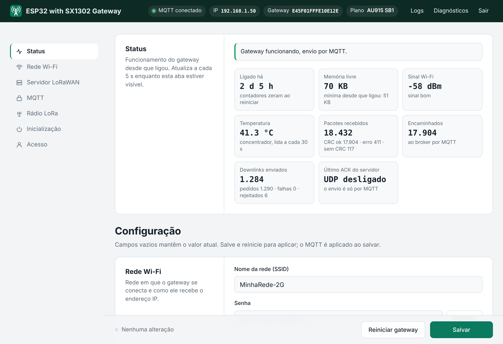
</p>

**Barra superior** (fica fixa no topo ao rolar):

| Elemento | O que mostra |
|---|---|
| Ponto + texto MQTT | 🟢 *MQTT conectado* · 🟠 *MQTT desconectado* · ⚪ *MQTT desativado* (vem do `/status`) |
| IP | Endereço usado para abrir a página |
| Gateway | Gateway ID. Muda enquanto você digita no campo |
| Plano | Plano de frequência marcado (AU915 SB0/SB1, US915, EU868, CN470). Muda ao clicar em outro |
| Logs · Diagnósticos · Sair | Atalhos para as outras telas e para encerrar a sessão |

**Menu lateral:** Status, Rede Wi-Fi, Servidor LoRaWAN, MQTT, Rádio LoRa, Inicialização e Acesso. Clicar rola até a seção; ao rolar a página, o item da seção visível fica marcado.

#### 1.1 Painel de status

Lê `GET /status` a cada **5 s**, só enquanto a aba está visível. Um pedido novo só sai depois da resposta do anterior, para não sobrecarregar o ESP32.

A faixa no topo resume a situação:

| Faixa | Quando aparece |
|---|---|
| 🟢 *Gateway funcionando, servidor LoRaWAN respondendo.* | Forwarder rodando por UDP e o último `PULL_ACK` é recente |
| 🟢 *Gateway funcionando, envio por MQTT.* | Forwarder rodando com MQTT ativado |
| 🟠 *Encaminhador parado…* | O concentrador não iniciou (veja a fiação) ou o gateway está em Soft AP |
| 🟠 *O servidor LoRaWAN ainda não respondeu…* / *não responde há …* | Nenhum `PULL_ACK` recebido, ou o último é mais velho que o intervalo de estatística (mín. 30 s) |
| 🟠 *Sem resposta do gateway. Tentando de novo…* | O navegador perdeu contato com o gateway |

Os oito cartões:

| Cartão | Valor | Linha de baixo |
|---|---|---|
| Ligado há | Uptime (`2 d 5 h`, `14 min 3 s`…) | Lembra que os contadores zeram ao reiniciar |
| Memória livre | Heap interno livre | Mínimo já atingido desde que ligou |
| Sinal Wi-Fi | RSSI do AP em dBm | *sinal bom* (≥ −60), *regular* (≥ −75), *fraco*; ou *sem conexão Station* |
| Temperatura | Leitura do STTS751 do HAT | Intervalo de leitura, ou *aguardando a primeira leitura* |
| Pacotes recebidos | Total de pacotes de RF | CRC ok · erro · sem CRC |
| Encaminhados | Pacotes enviados ao servidor | *ao servidor por UDP* ou *ao broker por MQTT* |
| Downlinks enviados | TX feitos pelo concentrador | Pedidos · falhas · rejeitados (colisão, cedo/tarde demais) |
| Último ACK do servidor | Idade do último `PULL_ACK` (UDP) | % de `PUSH_DATA` e `PULL_DATA` confirmados. Com MQTT: *UDP desligado* |

O mesmo painel no tema escuro e logo depois do primeiro boot, em Soft AP (concentrador ainda parado):

<p align="center">
  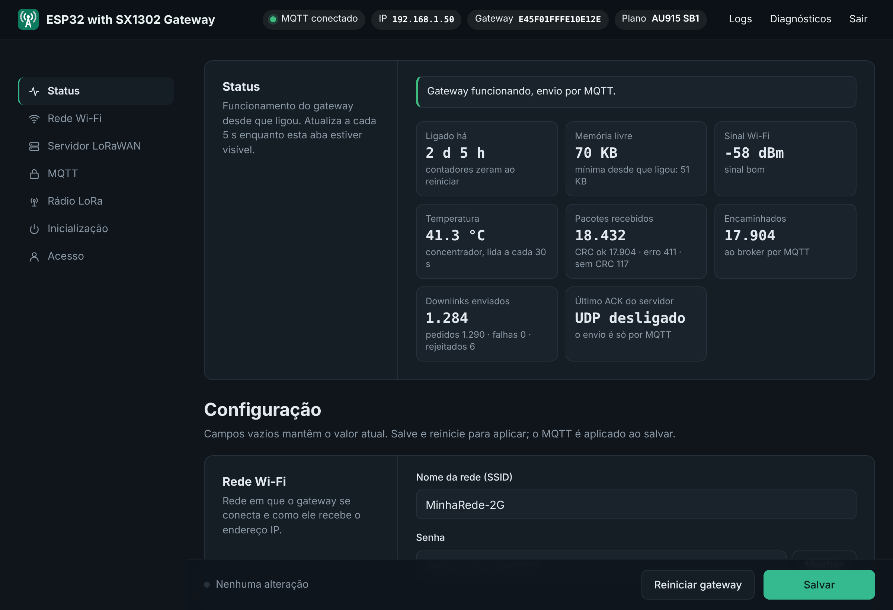
</p>

<p align="center">
  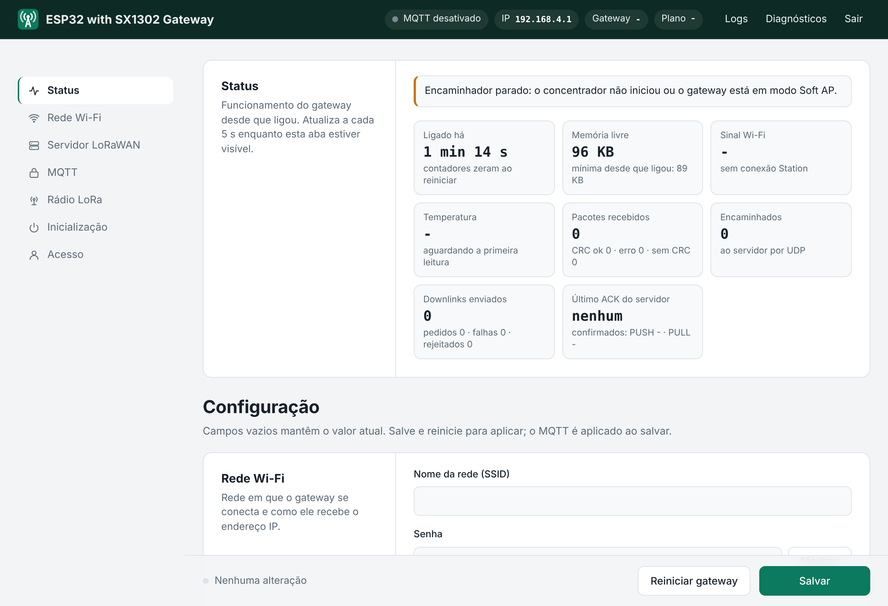
</p>

#### 1.2 Rede Wi-Fi

<p align="center">
  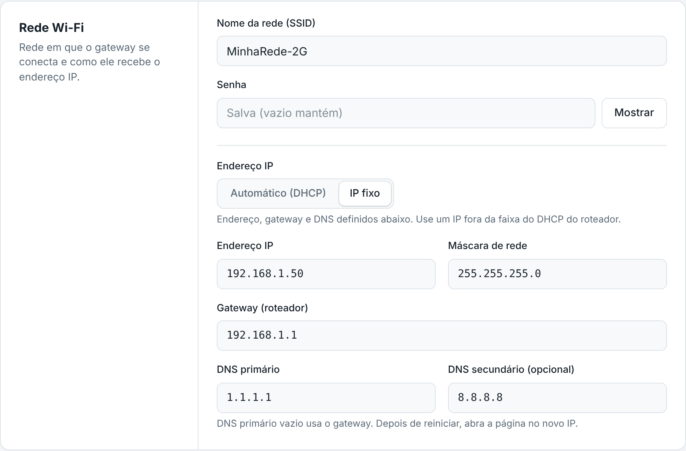
</p>

| Campo | Para que serve |
|---|---|
| Nome da rede (SSID) | Rede em que o gateway entra no modo Station. Só caracteres ASCII |
| Senha | Mínimo de 8 caracteres. **Mostrar/Ocultar** exibe o que foi digitado. Vazio mantém a senha salva |
| Endereço IP | **Automático (DHCP)** ou **IP fixo** |
| Endereço IP, Máscara, Gateway (roteador) | Obrigatórios com IP fixo. A máscara vazia vira `255.255.255.0`. A página sugere o IP atual e o roteador `x.x.x.1` |
| DNS primário / secundário | Primário vazio usa o roteador; secundário é opcional (sugestão `8.8.8.8`) |

Com IP fixo, a página confere se o roteador está na mesma rede do IP (pela máscara) e se não é o próprio IP. Depois de reiniciar, abra a página no IP novo.

#### 1.3 Servidor LoRaWAN (UDP)

<p align="center">
  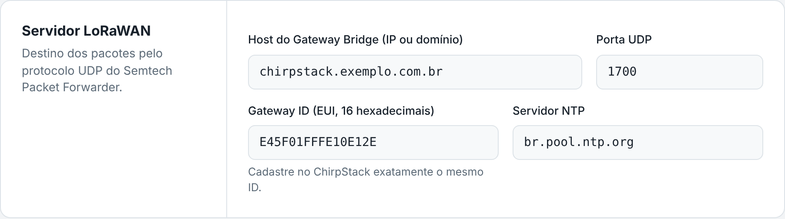
</p>

| Campo | Para que serve |
|---|---|
| Host do Gateway Bridge | IP ou domínio do ChirpStack Gateway Bridge (sem `http://`) |
| Porta UDP | Normalmente `1700` |
| Gateway ID | EUI de 16 hexadecimais. É convertido para maiúsculas ao salvar. Cadastre o mesmo ID no ChirpStack |
| Servidor NTP | Padrão `br.pool.ntp.org` |

Com o MQTT ativado aparece o aviso *“UDP desligado”*: host e porta continuam guardados para quando o MQTT for desligado. O Gateway ID e o NTP valem nos dois modos.

#### 1.4 MQTT

<p align="center">
  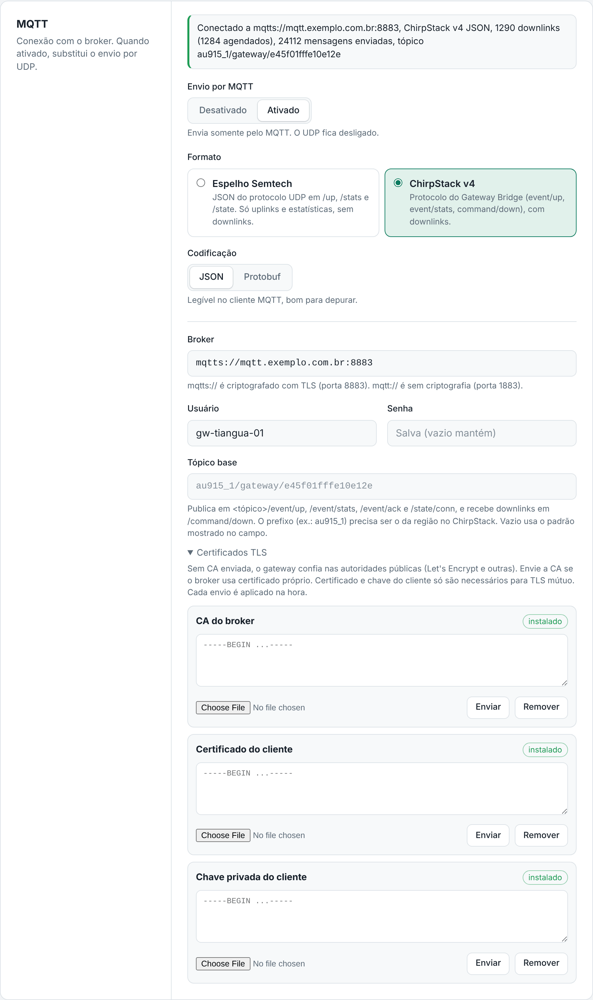
</p>

A faixa do topo mostra o estado ao vivo: broker, formato, codificação, downlinks recebidos/agendados, mensagens enviadas e tópico. Em caso de falha, mostra o último erro (*“Não conectado a … : <erro>”*).

| Campo | Opções |
|---|---|
| Envio por MQTT | **Desativado** (só UDP) · **Ativado** (só MQTT; o UDP desliga) |
| Formato | **Espelho Semtech** (JSON do UDP em `/up`, `/stats`, `/state`, sem downlinks) · **ChirpStack v4** (`event/up`, `event/stats`, `event/ack`, `state/conn`, `command/down`, com downlinks) |
| Codificação | **JSON** ou **Protobuf**. Só aparece no formato ChirpStack v4 |
| Broker | `mqtts://host:8883` (TLS) ou `mqtt://host:1883`. `ws://`/`wss://` também são aceitos. Obrigatório com o MQTT ativado |
| Usuário / Senha | Credenciais do broker. Senha vazia mantém a salva |
| Tópico base | Vazio usa o padrão mostrado em cinza, calculado na hora: `au915_1/gateway/<id em minúsculas>` (ChirpStack, prefixo da região escolhida) ou `gateway/<ID>` (Semtech) |

**Certificados TLS** (clique para abrir): três caixas, **CA do broker**, **Certificado do cliente** e **Chave privada do cliente**, cada uma com o selo *instalado / não instalado*. Cole o PEM ou escolha um arquivo (`.pem`, `.crt`, `.cer`, `.key`, `.txt`) e clique em **Enviar**; **Remover** apaga (pede confirmação). Cada envio vai por `POST /mqtt_cert?type=ca|crt|key`, fica na NVS (até 8 KB cada) e reconecta o MQTT **na hora**, sem precisar de *Salvar*.

- Sem CA enviada, o broker é validado pelo bundle público do ESP-IDF (Let's Encrypt e outros).
- Certificado e chave do cliente só são usados juntos (TLS mútuo).

As configurações de MQTT valem assim que você clica em **Salvar**; não precisa reiniciar.

#### 1.5 Rádio LoRa

<p align="center">
  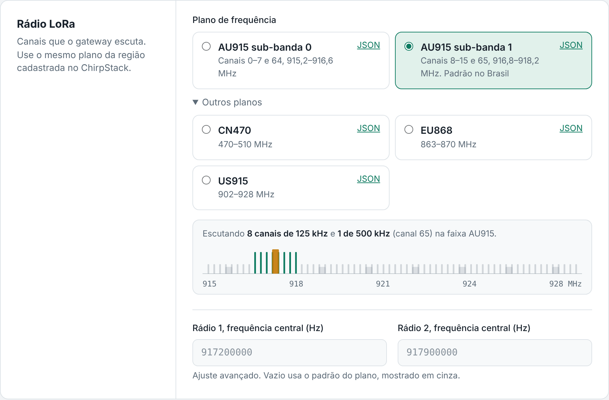
</p>

- **Plano de frequência:** AU915 sub-banda 0 e sub-banda 1 (padrão no Brasil) ficam à vista; CN470, EU868 e US915 ficam em **Outros planos** (abre sozinho se um deles estiver salvo). Cada opção tem o link **JSON**, que abre o arquivo do plano em uma aba nova.
- **Gráfico da faixa AU915:** mostra os 64 canais de 125 kHz e os 8 de 500 kHz entre 915 e 928 MHz, com os 8 + 1 canais escutados em destaque. Só aparece nos planos AU915.
- **Rádio 1 / Rádio 2, frequência central (Hz):** ajuste avançado. Vazio usa o padrão do plano, que aparece em cinza. Precisa ter 9 dígitos e ficar dentro da faixa do plano (ex.: 915–928 MHz no AU915).

#### 1.6 Inicialização e 1.7 Acesso

<p align="center">
  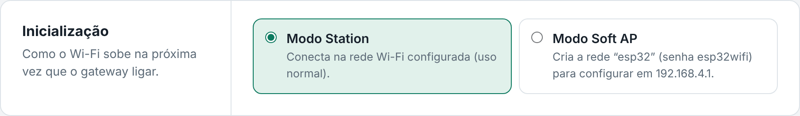
</p>

- **Modo Station:** conecta na rede Wi-Fi configurada (uso normal).
- **Modo Soft AP:** na próxima vez sobe a rede `esp32` (senha `esp32wifi`) para configurar em `192.168.4.1`. O botão **BOOT** logo após o reset faz o mesmo sem mexer nesta opção.

<p align="center">
  
</p>

- **Usuário**, **Nova senha** e **Confirmar nova senha** da própria página. Senha vazia mantém a atual. Ao salvar uma troca, o navegador pede o novo login.

#### 1.8 Salvar, reiniciar e validação

A barra do rodapé mostra *“Nenhuma alteração”* ou, com um ponto laranja, *“Alterações não salvas”*. Se você tentar sair da página com alterações pendentes, o navegador avisa.

- **Salvar** (`POST /resp`): valida os campos, grava na NVS e aplica na hora o **MQTT** e o **login**. O resto (Wi-Fi, IP, servidor UDP, plano, rádios, NTP, modo de boot) vale depois de reiniciar. **Campos vazios mantêm o valor atual.**
- **Reiniciar gateway** (`POST /reboot`): pede confirmação e reinicia.

Antes de enviar, a página confere os campos e lista todos os problemas de uma vez no topo do formulário:

<p align="center">
  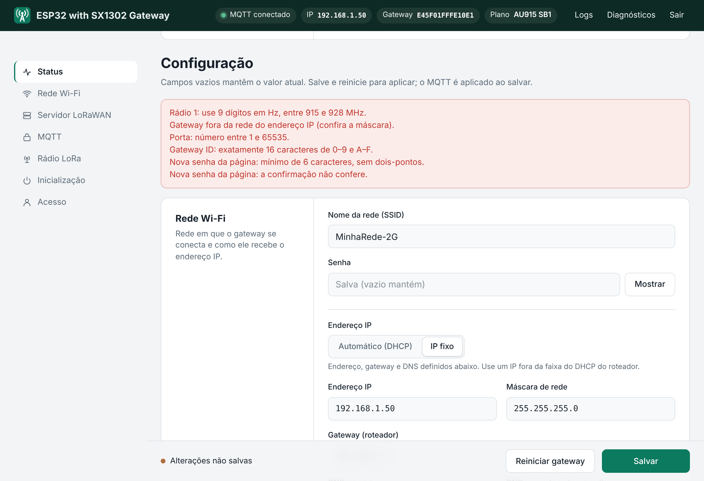
</p>

| Campo | Regra |
|---|---|
| Rádio 1 / 2 | 9 dígitos em Hz, dentro da faixa do plano |
| Senha do Wi-Fi | Mínimo de 8 caracteres |
| IP fixo | IP, máscara e gateway obrigatórios, no formato `192.168.1.50`; máscara válida; gateway na mesma rede e diferente do IP |
| Host | Só IP ou domínio, sem `http://` e sem espaços |
| Porta | 1 a 65535 |
| Gateway ID | Exatamente 16 caracteres de `0–9` e `A–F` |
| Broker MQTT | `mqtt://`, `mqtts://`, `ws://` ou `wss://`; obrigatório com MQTT ativado |
| Usuário da página | 1 a 31 caracteres, sem `:` |
| Nova senha da página | Mínimo de 6 caracteres, sem `:`, igual à confirmação |

O firmware também confere o login: se um usuário ou senha inválido chegar a ser gravado (vazio, longo demais, com `:` ou o usuário `_logout_`), ele volta a usar o padrão `admin` / `lorawan`.

#### 1.9 Telas de confirmação

<p align="center">
  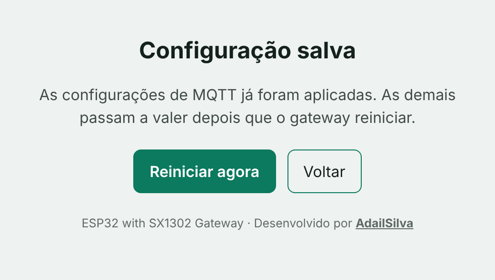
</p>

<p align="center">
  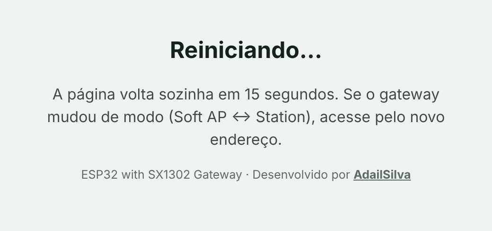
</p>

<p align="center">
  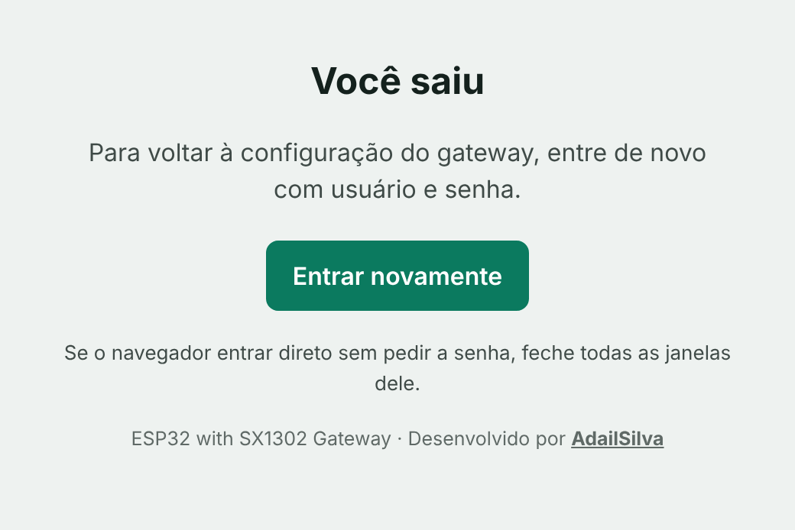
</p>

| Tela | Quando aparece | Botões |
|---|---|---|
| **Configuração salva** | Depois de *Salvar*. Se o login mudou, avisa que o navegador vai pedir o novo | **Reiniciar agora** · **Voltar** |
| **Reiniciando…** | Depois de reiniciar. Volta sozinha para `/` em 15 s. Se o modo mudou (Soft AP ↔ Station), abra pelo novo endereço | — |
| **Você saiu** | Depois de *Sair* | **Entrar novamente**. Se o navegador entrar sem pedir senha, feche todas as janelas dele |

### 2. Logs (`/logs`)

Mostra a mesma saída do console serial, ao vivo, sem precisar de cabo USB.

<p align="center">
  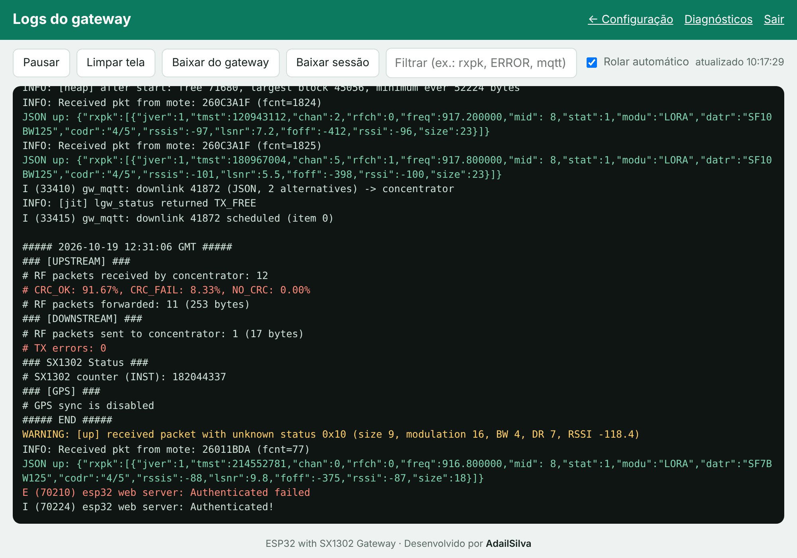
</p>

- **Atualização:** a cada 1,5 s (`GET /logs_data?from=<posição>`), só com a aba visível. Quando há muito texto acumulado, busca de novo logo em seguida.
- **Memória:** o gateway guarda os últimos **16 KB** em RAM (`WEBLOG_SIZE` em `weblog.h`); a página guarda até **3000 linhas**. Se algo foi descartado entre duas leituras, aparece *“[… N bytes antigos descartados …]”*.
- **Cores:** 🔴 erros (`ERROR`, `E (`, `failed`) · 🟡 avisos (`WARN`, `W (`) · 🟢 pacotes recebidos (`rxpk`, `JSON up`).
- **Pausar / Continuar** para de buscar texto novo. **Limpar tela** limpa só a tela (o gateway continua guardando).
- **Filtrar:** mostra só as linhas que contêm o texto (sem diferenciar maiúsculas), por exemplo `rxpk`, `ERROR`, `mqtt`.
- **Rolar automático:** mantém a última linha visível.
- **Baixar do gateway** (`/logs_download`): arquivo `esp32_sx1302_<GatewayID>_<AAAAMMDD-HHMMSS>.log` com tudo o que está na RAM do gateway, sem os códigos de cor ANSI. Sem hora do NTP, o nome usa o uptime.
- **Baixar sessão:** gera no navegador `esp32_sx1302_sessao_<data-hora>.log` com tudo o que a página recebeu desde que foi aberta.

<p align="center">
  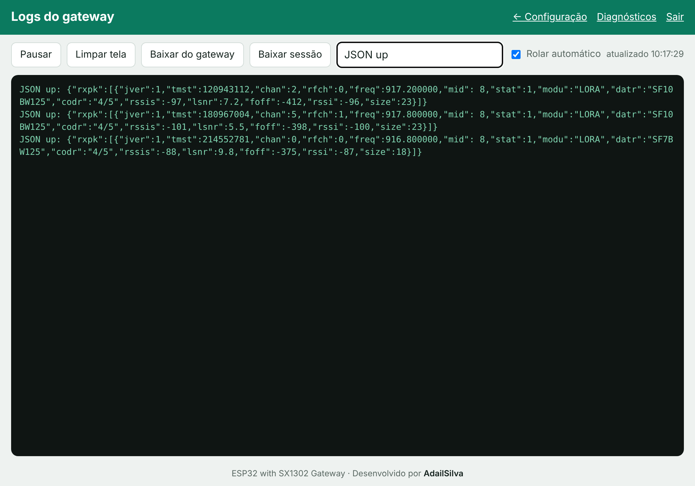
</p>

> Mensagens anteriores ao início do log web (bootloader, `cpu_start`) só aparecem na porta serial.

### 3. Diagnósticos (`/diag`)

Testes de rede feitos **a partir do gateway**, no estilo da tela *Network → Diagnostics* do OpenWrt. Ajudam a separar problema de Wi-Fi, de DNS e de servidor.

<p align="center">
  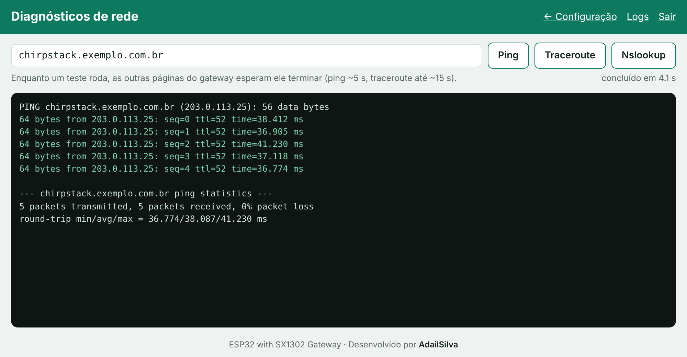
</p>

- **Destino:** já vem com o host do servidor LoRaWAN. A lista de sugestões traz o servidor LoRaWAN, o host do broker MQTT, o roteador Wi-Fi, `8.8.8.8` e `openwrt.org`. Aceita IP ou nome de até 63 caracteres.
- **Ping:** 5 pacotes ICMP, 1 por segundo, com resumo de perda e min/média/máx. **Enter** no campo também roda o ping.
- **Traceroute:** até 15 saltos, 1 tentativa de 1 s por salto (`*` = sem resposta).
- **Nslookup:** resolve o nome pelo DNS que o gateway usa e mostra o servidor DNS e os endereços.
- O resultado chega linha a linha (`GET /diag_run?t=ping|trace|dns&h=<destino>`). **Parar** interrompe; o rodapé mostra o tempo gasto.
- Enquanto um teste roda, as outras páginas do gateway esperam ele terminar (ping ~5 s, traceroute até ~15 s), porque o servidor HTTP atende um pedido por vez.

<p align="center">
  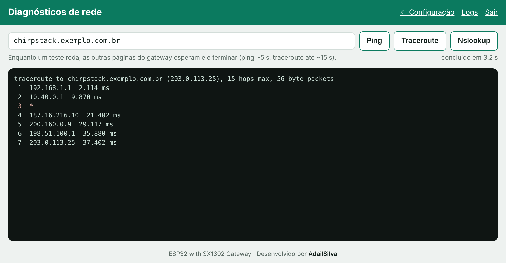
</p>

<p align="center">
  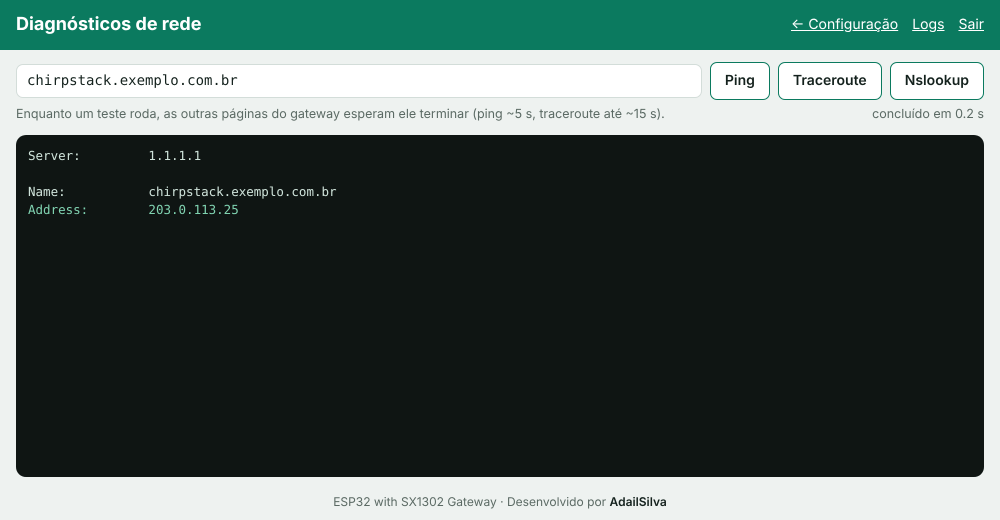
</p>

### 4. JSON do plano de frequência

Os links **JSON** da seção Rádio LoRa abrem o `global_conf.json` embutido de cada plano (`/au915_sb0`, `/au915_sb1`, `/us915`, `/eu868`, `/cn470`), com os comentários que explicam o mapeamento dos canais. É o modelo que o gateway usa no boot, antes de aplicar o que foi salvo na página (frequências dos rádios, servidor, Gateway ID).

<p align="center">
  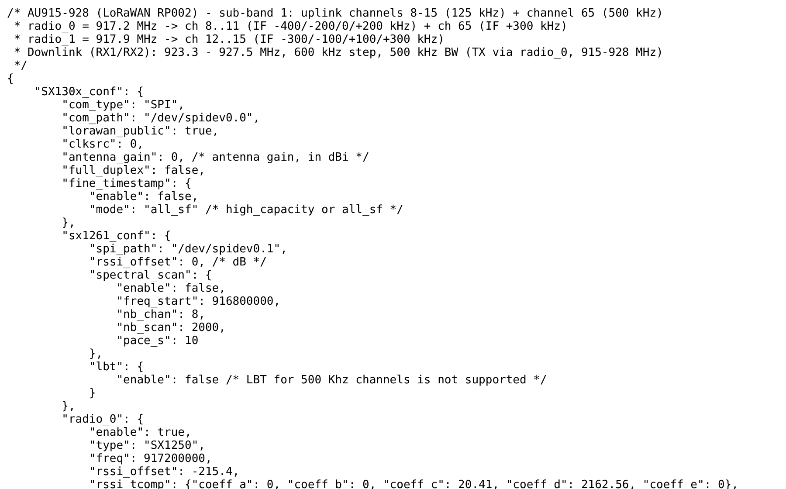
</p>

### 5. No celular

<p align="center">
  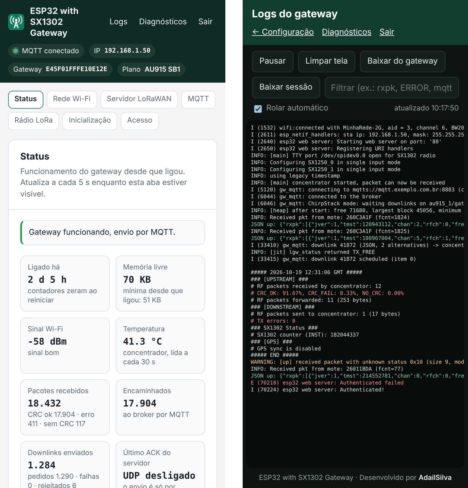
</p>

### Endereços HTTP

| Método | Caminho | Login | Resposta |
|---|---|:---:|---|
| GET | `/` (e `/w`) | ✅ | Página de configuração com os valores salvos |
| POST | `/resp` | ✅ | Recebe o formulário, grava na NVS, aplica MQTT e login, devolve *Configuração salva* |
| POST | `/reboot` | ✅ | Página *Reiniciando…* e reinício do ESP32 |
| GET | `/status` | ✅ | `{"gw":{...},"mqtt":{...}}`: uptime, heap, RSSI, temperatura, contadores de RX/TX/UDP e estado do MQTT |
| POST | `/mqtt_cert?type=ca\|crt\|key` | ✅ | Corpo = PEM (vazio remove). `{"ok":true}` ou `{"ok":false,"error":"..."}`; acima de 8 KB, `413` |
| GET | `/logs` | ✅ | Página de logs |
| GET | `/logs_data?from=<n>` | ✅ | Texto novo desde a posição `n`; cabeçalhos `X-Log-Start` e `X-Log-Next` |
| GET | `/logs_download` | ✅ | Arquivo `.log` com todo o buffer em RAM |
| GET | `/diag` | ✅ | Página de diagnósticos |
| GET | `/diag_run?t=ping\|trace\|dns&h=<host>` | ✅ | Resultado em texto, enviado linha a linha; `400` se o teste ou o destino for inválido |
| GET | `/au915_sb0`, `/au915_sb1`, `/us915`, `/eu868`, `/cn470` | ✅ | JSON do plano dentro de `<pre>` |
| GET | `/logout` | — | Só aceita o login falso `_logout_`; usado pelo link *Sair* |
| GET | `/saiu` | — | Página *Você saiu* |
| GET | `/favicon.svg`, `/favicon.ico` | — | Ícone do gateway |

Exemplo com `curl` na rede local:

```bash
curl -s -u admin:lorawan http://192.168.1.50/status | jq .gw.rx
curl -s -u admin:lorawan -o gw.log http://192.168.1.50/logs_download
curl -s -u admin:lorawan "http://192.168.1.50/diag_run?t=ping&h=8.8.8.8"
```

---

## ⚙️ Configuração

### Páginas web

As telas, os campos e todos os endereços HTTP estão em [Servidor web embutido](#-servidor-web-embutido).

### Console serial (`ESP32_SX1302>`)

| Comando | Para que serve |
|---|---|
| `config` | Mostra e altera tudo o que a página altera: `--region`, `--radio0/1`, `--ntp`, `--mode station\|soft_ap`, `--ssid`, `--wifi-pass`, `--host`, `--port`, `--gwid`, `--ip-mode dhcp\|static`, `--ip`, `--mask`, `--gw`, `--dns1/2`, `--reboot` |
| `mqtt` | `--on`/`--off`, `--uri mqtts://host:8883`, `--user`, `--pass`, `--topic`, `--format chirpstack\|semtech`, `--encoding json\|protobuf` |
| `mqtt_cert` | Grava a CA, o certificado ou a chave do cliente (cole o PEM no terminal) |
| `web_auth` | Troca o usuário/senha da página (`--reset` volta para `admin`/`lorawan`) |
| `pkt_fwd` | Inicia o forwarder pela linha de comando |
| `reboot` | Reinicia o gateway |

### Tópicos MQTT

| Formato | Tópico base padrão | Tópicos |
|---|---|---|
| ChirpStack v4 | `<região>/gateway/<gateway id>`, ex.: `au915_1/gateway/0016c001ff10a235` | `event/up`, `event/stats`, `event/ack`, `state/conn` (LWT), `command/down` |
| Semtech JSON | `gateway/<GATEWAY ID>` | `up`, `stats`, `state` |

Prefixo de região: `au915_0` (SB0), `au915_1` (SB1), `us915_0`, `eu868` e `cn470_10`. Esse prefixo precisa bater com o `topic_prefix` da região no ChirpStack.

---

## 🗺️ Roadmap (ESP32-S3)

O ESP32-WROOM-32U fica com o conjunto atual e passa a receber só correções. As funções novas entram no **ESP32-S3-WROOM-2 (N32R16V)**, ligadas por opções de Kconfig com valor padrão por alvo. Assim o código não fica cheio de `#if CONFIG_IDF_TARGET_ESP32S3`.

- [x] Pinagem própria e console no USB nativo
- [x] Flash 32 MB e PSRAM 16 MB octais (`sdkconfig.defaults.esp32s3`)
- [ ] `main/Kconfig.projbuild` com as flags de funcionalidade (`GW_*`)
- [ ] Filas de RX/TX, buffer MQTT e sessão TLS na **PSRAM**
- [ ] Tabela de partições de 32 MB (OTA A/B + partição de dados)
- [ ] **OTA** por HTTPS, com o alvo no nome do binário
- [ ] **Buffer offline** em flash para uplinks quando o broker cair
- [ ] **GPS + PPS** (GPIO16 sugerido para o PPS) e timestamp GPS nos uplinks
- [ ] **LBT / spectral scan** com o SX1261
- [ ] LED RGB WS2812 de status
- [ ] Painel web completo (gráficos de RSSI/SNR e histórico de pacotes)
- [ ] Alvo (`esp32`/`esp32s3`) na versão reportada por MQTT e na página

---

## 📁 Estrutura do repositório

```
esp32_sx1302/
├── .github/workflows/build.yml   # CI: compila esp32 + esp32s3, publica Release nas tags v*
├── CMakeLists.txt                # projeto ESP-IDF
├── sdkconfig.defaults            # opções comuns às duas placas
├── sdkconfig.defaults.esp32s3    # WROOM-2 N32R16V: flash/PSRAM octais, console USB
├── platformio.ini                # ambientes esp32dev e esp32s3
├── scripts/
│   ├── build.sh                  # build/flash por alvo (build-<alvo>/, sdkconfig.<alvo>)
│   ├── gen_headers.sh            # gera webpage.h e global_json.h
│   └── dump_html.py, json_to_hex_array.py, upgrader.py, udp_*.py
├── main/
│   ├── CMakeLists.txt            # fontes + PINAGEM POR PLACA (if IDF_TARGET ...)
│   ├── idf_component.yml         # esp-mqtt pelo Component Registry (IDF ≥ 6)
│   ├── libloragw/                # porte do SX1302_HAL v2.1.0
│   ├── libloragw-test/           # ferramentas de teste (CONFIG_LIBLORAGW_TEST)
│   ├── libtools/                 # parson (JSON), base64, tinymt32
│   └── packet_forwarder/         # forwarder, MQTT, web, log, diagnóstico
│       └── global_conf.json/     # planos AU915 SB0/SB1, US915, EU868, CN470
├── doc/
│   ├── images/                   # diagramas SVG deste README
│   │   └── web/                  # capturas das telas do servidor web
│   ├── hardware/                 # guia de ligação de cada placa
│   ├── CHANGELOG.md, user_guide.md, notes_tips.md, todo_issue_list.md
└── hardware_design/              # placa-mãe e caixa do projeto original (referência)
```

---

## 🩺 Solução de problemas

| Sintoma | O que verificar |
|---|---|
| `failed to start the concentrator` | O firmware imprime um diagnóstico de fiação. Confira MOSI/MISO/SCLK/CS e RESET, os 5 V e o GND. Use fios SPI curtos. O CS do SX1261 (pino 31) **não** pode ficar solto. |
| Leitura do SX1302 retorna `0x00` ou `0xFF` | MISO desconectado ou CS errado. Confira os pinos 21 e 24 do HAT. |
| Reset ou *brownout* ao transmitir | Alimentação. Use a fonte de 5 V / 2 A. |
| `failed to read I2C device 0x38` / temperatura desconhecida | O HAT não tem STTS751 ou o I2C não está ligado. O gateway funciona e usa 25 °C na compensação de RSSI. |
| ESP32-S3 não inicia depois da gravação | Faltam as opções octais. Confira se o `sdkconfig.defaults.esp32s3` foi aplicado (apague `sdkconfig.esp32s3` e `build-esp32s3/` e compile de novo). |
| Nada aparece no monitor do S3 | Use a porta **USB nativa** (`/dev/ttyACM0`), não a UART. |
| MQTTS conecta mas nada é enviado (ESP32) | Pouca RAM. Confira as linhas `INFO: [heap]` do log. O `sdkconfig.defaults` já liga os buffers TLS dinâmicos. |

---

## 📜 Créditos e licença

- Porte original do **ESP32_SX1302** (ex-ESXP1302) para ESP32: Dennis Deng (Semtech).
- [SX1302_HAL](https://github.com/Lora-net/sx1302_hal) © Semtech.
- Adaptações para AU915, MQTT/ChirpStack v4, página web pt-BR, ESP32-WROOM-32U + ESP32-S3-WROOM-2 com o LR1302 HAT: **Adail dos Santos Silva** ([k8s.adailsilva.com.br](https://k8s.adailsilva.com.br/)).

Distribuído sob a licença **BSD de 3 cláusulas**. Veja [LICENSE.TXT](LICENSE.TXT).
